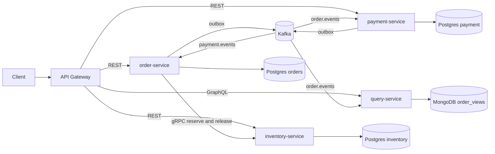
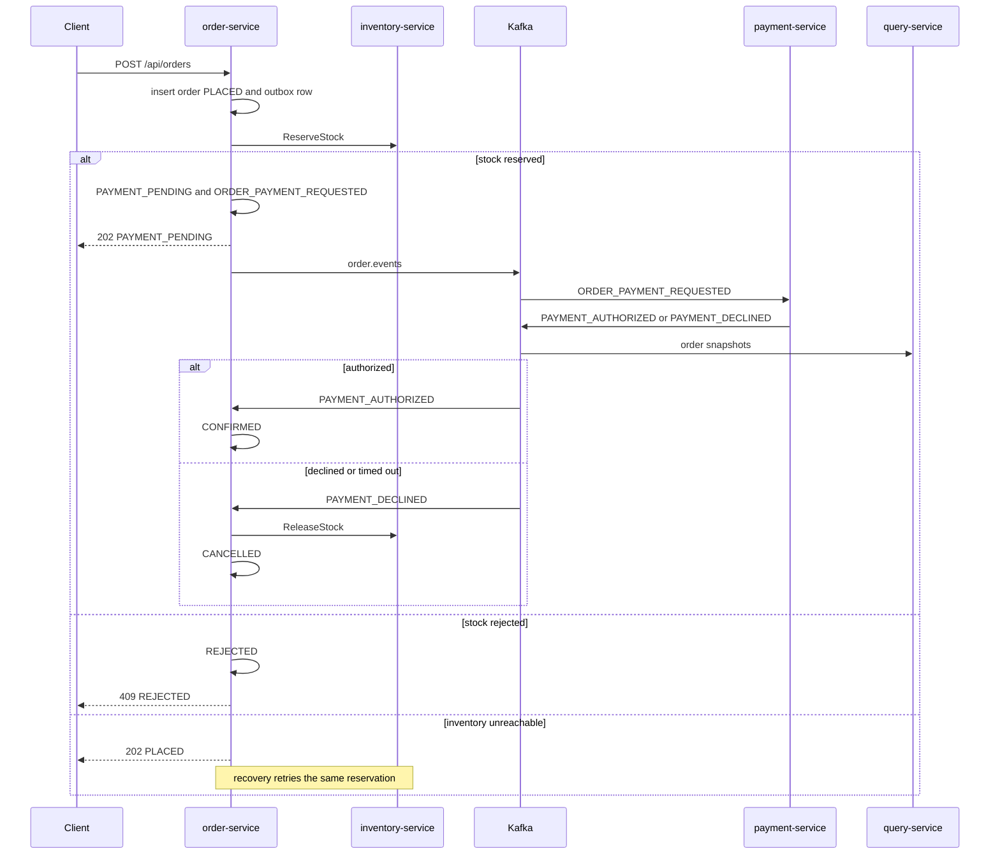

# orderflow

`orderflow` is a small order-processing system built the way a backend interview expects to see it: four services, one gateway, a synchronous stock reservation, and an asynchronous payment saga that can undo itself.

A customer places an order through the gateway. The order service writes the order and an outbox row in one Postgres transaction, then calls inventory over gRPC to reserve stock. If the reservation holds, it asks payment to charge the card or wallet. Payment publishes the result. The order service confirms the order or releases the stock and cancels it. A query service keeps a MongoDB read model and exposes it over GraphQL. The write model and the read model are not the same database, and they are not updated in the same transaction.



The happy path and the decline path:



## Run it

Requirements: Docker with Compose, and nothing else for the demo. Java 21 and Maven 3.9+ are only needed to run the tests on the host.

```bash
docker compose up --build
```

Compose publishes the dev defaults from `.env.example`. Copy that file to `.env` only if you want to change a port. The passwords in it are local defaults, not credentials for anything real.

| Surface | URL |
| --- | --- |
| Gateway | http://localhost:8080 |
| Order write API and OpenAPI | http://localhost:8081/swagger-ui.html |
| Inventory HTTP and OpenAPI | http://localhost:8082/swagger-ui.html |
| Payment lookup and OpenAPI | http://localhost:8083/swagger-ui.html |
| GraphiQL | http://localhost:8080/graphiql |
| Prometheus | http://localhost:9095 |

The gateway proxies `/api/orders`, `/api/stock`, `/api/payments`, `/graphql`, and `/graphiql`. Swagger UI stays on each service. Prometheus scrapes every service's `/actuator/prometheus`.

Wait until `docker compose ps` shows the application containers healthy. The first build compiles inside the image, so it is slower than a later start.

Place an order. `SKU-100` and `SKU-200` start with 1,000,000 units. `SKU-LOW` has 1. A card token ending in `0002` is declined. A wallet charge above 50,000 minor units ($500.00) is declined. Money is integer minor units.

```bash
curl -sS -D - -X POST http://localhost:8080/api/orders \
  -H 'Content-Type: application/json' \
  -H 'X-Correlation-Id: demo-1' \
  -H 'Idempotency-Key: demo-key-001' \
  -d '{
    "customerId": "cus_1001",
    "currency": "USD",
    "paymentMethod": "CARD",
    "paymentToken": "tok_visa_4242",
    "lines": [{"sku": "SKU-100", "quantity": 2, "unitPriceMinor": 1999}]
  }'
```

The response is `202` with status `PAYMENT_PENDING` when stock was reserved. Read it back, then read the projection. The REST document is the write model and is current immediately. GraphQL lags until the order events have been applied.

```bash
curl -sS http://localhost:8080/api/orders/<orderId>
curl -sS http://localhost:8080/api/stock/SKU-100
curl -sS http://localhost:8080/graphql \
  -H 'Content-Type: application/json' \
  -d '{"query":"{ order(id: \"<orderId>\") { id status totalMinor version } }"}'
```

A declined card compensates. Poll the order until `status` is `CANCELLED`. `SKU-200` available stock returns to 1,000,000.

```bash
curl -sS -D - -X POST http://localhost:8080/api/orders \
  -H 'Content-Type: application/json' \
  -H 'Idempotency-Key: demo-key-002' \
  -d '{
    "customerId": "cus_1001",
    "currency": "USD",
    "paymentMethod": "CARD",
    "paymentToken": "tok_decline_0002",
    "lines": [{"sku": "SKU-200", "quantity": 1, "unitPriceMinor": 1500}]
  }'
```

Repeating a request with the same `Idempotency-Key` and the same body returns the original order. The same key with a different body is `409`.

## Tests

```bash
mvn -B verify
```

Docker has to be running. Testcontainers starts Postgres, Kafka, and MongoDB. The saga test starts the four packaged services as separate processes against those containers, so the build packages the executable jars before that module runs.

`mvn -B verify` on this repository reported 42 tests, 0 failures, 0 errors, 0 skipped:

| Module | Tests |
| --- | --- |
| orderflow-common | 4 |
| inventory-service | 3 |
| order-service | 25 |
| payment-service | 4 |
| query-service | 3 |
| api-gateway | 2 |
| orderflow-e2e | 1 |

GitHub Actions runs the same command on Ubuntu with Java 21 (`.github/workflows/ci.yml`).

## Design decisions

**Split by who owns the data.** Orders, stock, and payments change for different reasons and have different failure modes. The gateway is the only HTTP front door. Services talk to each other with gRPC or events, not by sharing tables. The cost is distributed failure: a reserved order can sit in `PLACED` or `PAYMENT_PENDING` until recovery finishes it.

**REST at the edge, gRPC for the stock call.** Browsers and `curl` speak HTTP. Reserving stock is a synchronous, typed, latency-sensitive call on the place-order path, so it is gRPC with a deadline. Payment is slow and must be retryable, so it is a Kafka event. GraphQL is only the read model. One style everywhere would make either the public API or the internal call worse.

**Outbox, not a dual write.** The order row and the `ORDER_PAYMENT_REQUESTED` event are inserted in one Postgres transaction. A poller publishes the row and then marks it published. If the process dies between those two steps, the event is published again. Consumers are idempotent, so the duplicate is safe. Polling is simpler than a WAL reader and adds a few hundred milliseconds of latency. A crashed poller can also stall later events for that batch until the failed row is marked or dead-lettered.

**Saga, not two-phase commit.** Stock and payment are different databases. Two-phase commit would hold locks in both while payment runs, and it still fails badly when a participant disappears. The saga does the local work, then compensates: a decline or a payment timeout releases the reservation and cancels the order. Compensation is not free. A `PAYMENT_AUTHORIZED` that arrives after cancellation is logged and ignored. There is no automatic refund. That is a deliberate demo limit.

**Postgres for commands, MongoDB for queries.** The order, reservation, and payment records need transactions, constraints, and row locks. The query API wants one document per order and does not take writes from clients. Snapshots are applied only when `aggregateVersion` is newer, so the read model converges without a multi-document transaction. Right after `POST`, GraphQL can still show the previous status.

**Idempotency at every retry boundary.** The HTTP key is stored with a hash of the body. Inventory reservations are keyed by order id, so a retry returns the same reservation and a released order cannot reserve again. Payment uses an inbox plus a unique `order_id`. The order service uses an inbox for payment results. The query side uses the event id and the aggregate version.

**Patterns that own a decision.** State machines live in `OrderState`, payment methods are strategies, `Order.Builder` protects the aggregate, observers turn domain events into outbox rows and metrics, adapters hide gRPC and JPA, and validation is a chain. Each one is named in `LEARN.md` with the file that implements it.

**Resilience on the only synchronous remote call.** The inventory client retries, times out each attempt, and opens a circuit. A business rejection (`FAILED_PRECONDITION`) is a result, not a failure, so a missing SKU does not open the breaker. A timeout or an unreachable inventory leaves the order `PLACED` and returns `202`. `SagaRecoveryJob` retries the reservation. The same reservation id comes back, so the retry is safe.

## Load test

`loadtest/orders.js` drives the gateway. Each iteration posts an order for `SKU-100` and then reads it back. The post includes the synchronous inventory reservation. It returns at `PAYMENT_PENDING`. It does not wait for payment or for the GraphQL projection, so the numbers are gateway-plus-order-plus-inventory latency, not full saga latency.

The command, virtual users, duration, and the measured requests/sec, latency, and error rate are written in this section only after a run on a real machine. No results have been recorded yet.

## Limits worth saying out loud

- The outbox is a poller, not a change-data-capture stream.
- Events are JSON without a schema registry. A bad payload is dead-lettered rather than blocking the partition forever, but only after the configured attempts.
- The demo payment token is copied onto `ORDER_PAYMENT_REQUESTED` so payment can run without another RPC. The query model drops it. A real system would pass a vault reference.
- There is no refund if authorization wins the race with compensation.
- `COMPENSATING` is an internal status. Clients see `PAYMENT_PENDING` and then `CANCELLED`.
- Local compose runs three databases on one Postgres server.
- Payment gives up after 10 minutes by default (`orderflow.saga.payment-timeout-ms`).
